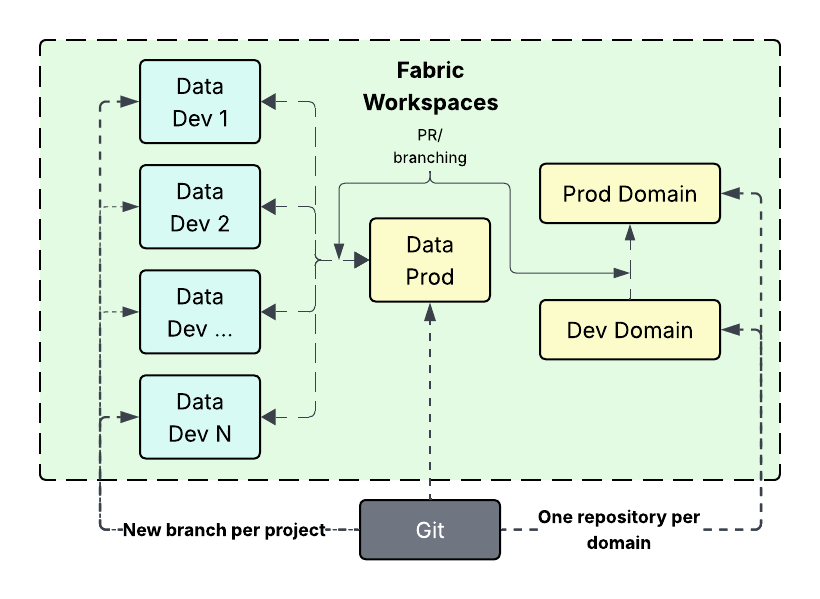

# Deployment & Git Integration
Setting up a robust deployment pipeline and version control strategy is critical to managing multiple developers in Microsoft Fabric without code collisions or pipeline breaks. It looks like this:



The data environment consists strictly of Dev and Prod workspaces dedicated to data engineering and the ELT pipeline. There is no separate Test workspace, as Dev also serves for testing. Introducing a shared Test workspace would create release bottlenecks when parallel projects are at different stages, forcing completed work to wait on unfinished projects before deploying to Prod while using the GitHub deplyment pipeline. All downstream reporting assets, semantic models, reports, and other analytical objects, live entirely within their respective business domain workspaces (see [Domain Workspaces](#domain-workspace) below).

## Git Integration Strategy

We use two workspace strategies: one for the central data workspace and another for domain-specific workspaces.

### Data Workspace
- **Repository Model:** Uses a single repository to centralize all ELT logic, simplifying CI/CD workflows.
- **Branch Structure:** Maintains a single long-lived branch (`main`), with all development done on short-lived feature branches created from `main`. While this can occasionally cause workspace sync conflicts, it ensures environments stay up to date with `main` and forces development against the latest codebase.

### Domain Workspace
- **Repository Model:** Uses a dedicated repository per domain to isolate access and ensure teams only modify their own domain assets.
- **Branch Structure:** Maintains two long-lived branches, `dev` and `main`, each mapped directly to its corresponding Fabric workspace. 

> [!NOTE]
> **Why bypass native Fabric Deployment Pipelines?**
> While Fabric offers native deployment pipelines, I don't use them because a workspace can only belong to a single native deveolpment pipeline. This creates a massive bottleneck for multi-developer workflows. Instead, we enforce a **Git-first, action-driven CI/CD workflow** (using GitHub Actions) for environment promotions.

## Environment Configuration
[Autobinding](https://learn.microsoft.com/en-us/fabric/cicd/deployment-pipelines/understand-the-deployment-process?tabs=new-ui#autobinding) keeps **notebooks** connected to the right Lakehouse in each workspace. For **semantic model** within each domain, a centralize configuration file is maintained in the Git repository. Semantic models typically connect to the Prod workspace, though they occasionally need to point to the Data Dev workspace to test new columns, tables or other specifications. In those instances, a coordinated deployment is executed: one PR promotes the data pipeline from Dev to Prod, then a PR promotes the reporting assets from the Dev Domain to the Prod Domain workspace.

How it works:
1. **Development**: Developers connect directly to the Lakehouses assigned to data dev or prod.
2. **Automated Promotion**: During CI/CD deployment via Pull Request (PR) into `main`, the actions automatically updates the connection strings.

> [!WARNING]
> This file must **never** contain secrets (Service Principal client secrets, connection passwords, API keys). It holds only workspace/Lakehouse IDs. Credentials for the Service Principal used for [semantic model ownership](ownership.md) are managed separately through the CI/CD platform's secret store (GitHub Actions secrets) or Key Vault, never through this file.

#### Config File Example (`config.json`)
```json
{
  "environments": {
    "dev_1": {
      "workspace_id": "dev1-workspace-uuid",
      "lakehouse_id": "dev1-lakehouse-uuid"
    },
    "dev_2": {
      "workspace_id": "dev2-workspace-uuid",
      "lakehouse_id": "dev2-lakehouse-uuid"
    },
    "prod": {
      "workspace_id": "prod-workspace-uuid",
      "lakehouse_id": "prod-lakehouse-uuid"
    }
  }
}
```

## Dev Workspaces
To prevent multiple developers from overwriting each other's work or corrupting active Fabric metadata, **there exists multiple development workspaces for data** (e.g., `Dev 1`, `Dev 2`, ..., `Dev N`).

* **The Workflow:**
1. A developer creates a feature branch off of the `main` or relevant branch in GitHub.
2. They connect their feature branch to an available workspace. 
3. They develop and commit changes inside their personal workspace.
4. Once development is complete, they submit a **Pull Request (PR)** to merge their feature branch into the `main` branch.

## Production Workspaces
To prevent manual changes and maintain strict environment control, the **Production workspaces** only assign Viewer and Admin (select few) roles, forcing all updates to run through the automated CI/CD pipeline. Merging a PR into the `main` branch automatically deploys the code and configures the correct connection strings.

### Rollback Strategy
A CI/CD pipeline is not complete without a way back out of a bad deployment:
* **Code:** A bad `main` deployment is reverted via a standard Git revert of the merge commit.