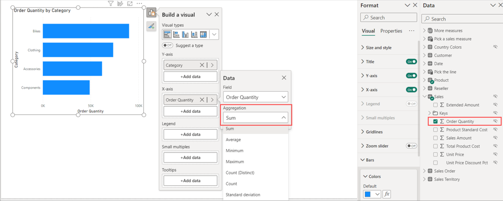
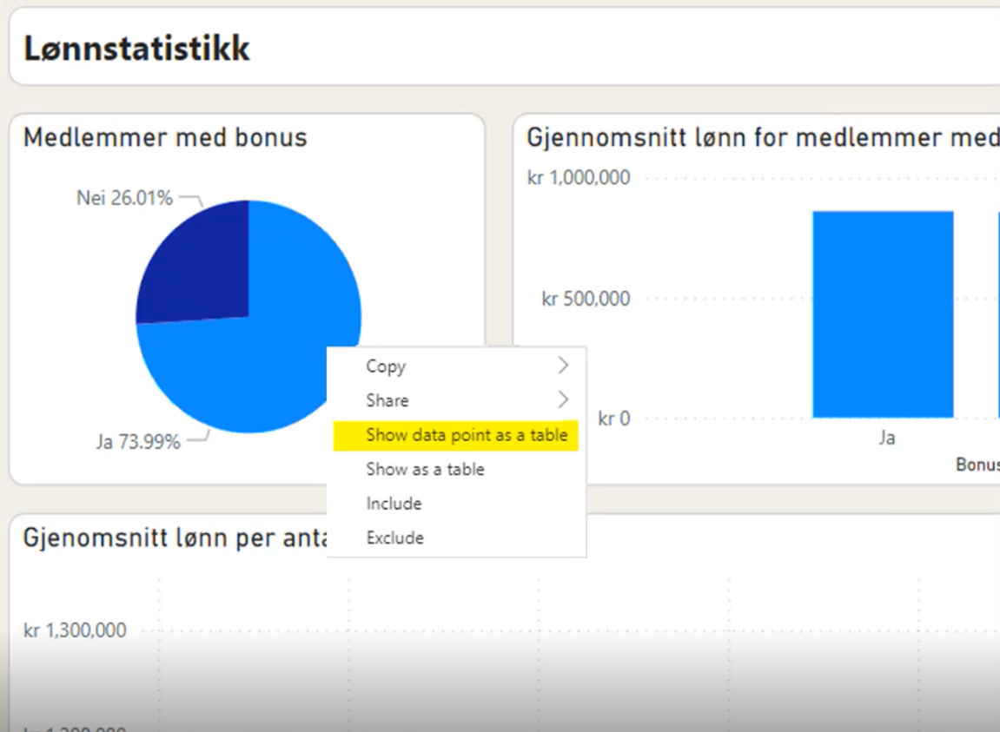
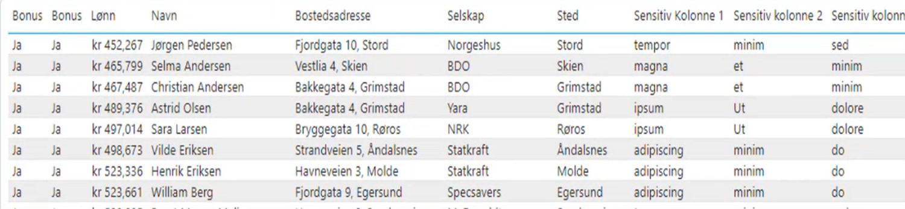

[Back to best practice data modeling overview](index.md)

# DAX

DAX is used to define calculations in the semantic model, either through calculated columns or measures. Measures are dynamic calculations that adjust based on the current filter context.

The general rule is that [DAX](https://learn.microsoft.com/en-us/dax/) calculations should be kept as simple as possible. Ideally, complex calculations and business logic calculations are stored in the [gold layer](../architecture/medallion.md#gold) so that complex DAX solutions are unnecessary. This is because more complicated DAX formulas cause [reports to take longer to load](../reporting/performance.md), which can negatively impact users. Nevertheless, there are cases where more advanced calculations are necessary to achieve desired results. For advanced DAX patterns, it is recommended to visit: [https://www.daxpatterns.com/](https://www.daxpatterns.com/). Remember to document your calculations, as this makes it easier for others to understand what the calculation does.


## Variables

Using variables in DAX calculations offers several advantages:

1. **Improves performance**, as calculations are stored in memory and can be reused without being recalculated multiple times.
2. **Easier to read** – Isolates intermediate steps into separate code snippets, making it easier to interpret what the calculations are doing.
3. **Quality assurance of the calculation** – Since variables are often intermediate calculations, you can verify that these steps are correct.

## Formatting

Formatting also makes it easier to understand how the code works:

* When referencing a column in DAX, the syntax should be: **Table[Column]**
* When referencing a measure in DAX, the syntax should be: **[Measure]**

**Example**: [SalesAmount] could be either a measure or a column. With correct formatting, there is no confusion: Fact_Sales[SalesAmount] or [SalesAmount].

## Best Practice

For help with formatting, use [https://www.daxformatter.com/](https://www.daxformatter.com/)

A poorly formatted DAX calculation looks like this:

```text
SalesGrowth = CALCULATE(SUM( [Amount]) - CALCULATE(SUM( [Amount]), SAMEPERIODLASTYEAR(Dates[Date]))) / CALCULATE(SUM(Sales[Amount]), SAMEPERIODLASTYEAR(Dates[Date])) + [Total Sales] – SUM ( Sales[Amount]) + (SUM(Sales[Amount]) / COUNT(Sales[OrderID]))

```

A well-formatted DAX calculation can look like this:

```text
SalesGrowth = 
    VAR CurrentSales = SUM( Sales[Amount] ) // Finds current sales given date/week/month/year filtering
    VAR PreviousSales = // Finds the same for the period last year
        CALCULATE( 
            SUM( Sales[Amount] ), 
            SAMEPERIODLASTYEAR( Dates[Date] ) 
        ) 
    VAR SalesDifference = CurrentSales – PreviousSales // Finds the difference
    VAR nOrders = COUNT( Sales[OrderID] ) 
    VAR AverageOrderValue = 
        DIVIDE( CurrentSales, nOrders ) 
    VAR totalSales = [Total Sales] // Referencing a measure 

    VAR result = // Random calculation as an example
        DIVIDE( SalesDifference, PreviousSales ) + totalSales - CurrentSales + AverageOrderValue
    
    RETURN result

```

## Implicit vs Excplicit Measures

In Power BI, the core difference between implicit and explicit measures comes down to how the calculation is created and where it can be used: 
* [Implicit measures](https://learn.microsoft.com/en-us/power-bi/transform-model/desktop-tutorial-create-measures#automatic-measures) are created automatically by dragging columns into visuals
* [Explicit measures](https://learn.microsoft.com/en-us/power-bi/transform-model/desktop-tutorial-create-measures#create-and-use-your-own-measures) are created manually using [DAX](../semantic_model/dax.md). 


Example of implicit measure: 



### Always use Explicit Measures
While implicit measures offer quick convenience, they can give access to the underlying data through [Show data point as a table](https://learn.microsoft.com/en-us/power-bi/explore-reports/end-user-show-data?tabs=powerbi-desktop#use-data-point-table-in-power-bi-desktop) and is only available with implicit measures, not explicit measures. However, this is not a replacement for real [governacne](../governance/index.md). 

Below is an example where the visuals shows the percentage of employee that have bonuses. However, if you select the *show data point as a table*, then the whole underlying table is available showing each employees salary (lønn):






**Other reasons to use Explicit Measures**
* More flexible calculations
* Easier formatting options
